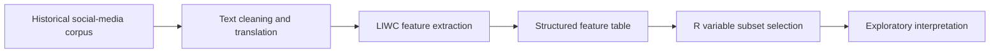

# Social-Media Language Analysis and Feature Selection

**Historical research portfolio · Text mining · Linguistic features · R statistical analysis · Research ethics**

> **Research integrity notice:** This is a retrospective academic project about linguistic feature analysis in social-media posts associated with suicide-related research. It is **not** a validated suicide-risk assessment system, diagnostic tool, or crisis-response application. Its findings must not be used to infer any individual's mental-health status or to make clinical decisions.

## Original thesis and presentation

| Original artifact | Open |
| --- | --- |
| Research report (PDF) | **[Suicidal_Prediction-Final.pdf](Suicidal_Prediction-Final.pdf)** |
| Project presentation (PowerPoint) | **[Prediction of suicidal behavior.pptx](Prediction%20of%20suicidal%20behavior.pptx)** |

The original files are preserved unchanged. The report and slides, rather than this README, remain the authoritative historical academic records.

## Research overview

The supplied working thesis documents explore whether **linguistic features extracted from historical Twitter content** differ between two manually selected groups in a retrospective dataset. They describe collection with the Twitter API, text preprocessing and translation, feature extraction using **Linguistic Inquiry and Word Count (LIWC)**, and subset-selection analysis in **R** using `leaps::regsubsets()`.

| Item | Reported in the uploaded working manuscript |
| --- | --- |
| Final analysis table | **132 observations**, 71 variables |
| Data context | Historic Twitter profiles and extracted text features |
| Language analysis | LIWC linguistic and psychological word categories |
| Statistical approach | R `regsubsets()` for exploratory variable selection |
| Research status | Historical, exploratory; no independently verified prospective validation |

*The 132/71 figures are transcribed from a working manuscript supplied with the project materials. They have not been independently reconciled against the PDF on GitHub or a reusable analysis dataset. These are historical descriptions, not validated model-performance measures.*

## Workflow described in the thesis



This flowchart summarizes the manuscript's reported process. **It is not a deployable prediction pipeline.** Full original data, preprocessing configuration, model-selection criteria and independent evaluation artifacts are not distributed here.

## Skills demonstrated

- **Research methods:** exploratory question framing and related-work review.
- **Data preparation:** collection, normalization and structured representations described in the thesis.
- **Feature engineering:** LIWC-based linguistic categories.
- **Statistical analysis:** variable-subset exploration in R.
- **Responsible research:** clear documentation of privacy, representativeness and validation gaps.

[Methodology](docs/METHODOLOGY.md) · [Research brief](docs/PROJECT_BRIEF.md) · [Ethics and limitations](docs/ETHICS_AND_LIMITATIONS.md) · [Reproducibility](docs/REPRODUCIBILITY.md)

## Reported observation and limits

The working manuscript reports exploring 71 variables and notes that the `leisure` word category appears in certain subset-selection summaries. **This is not evidence that leisure-related language causes, reliably predicts or diagnoses suicide-related outcomes.** The repository has no verified held-out evaluation, calibration study, prospective clinical validation or independently runnable original training process.

Important limitations include small, nonrandomly selected profiles, potential biases in the historical group labels, translation and dictionary constraints, unclear consent/data-use permissions, and a discrepancy between the number of collected files and the final 132-row analysis table. See [Ethics and limitations](docs/ETHICS_AND_LIMITATIONS.md).

## Repository structure

```text
Thesis/
├── Suicidal_Prediction-Final.pdf
├── Prediction of suicidal behavior.pptx
├── README.md
├── docs/
│   ├── PROJECT_BRIEF.md
│   ├── METHODOLOGY.md
│   ├── ETHICS_AND_LIMITATIONS.md
│   ├── REPRODUCIBILITY.md
│   └── PUBLICATION_CHECKLIST.md
├── examples/
│   └── subset_selection_demo.R
├── tools/
│   └── verify_artifacts.py
├── tests/
│   └── test_verify_artifacts.py
└── .github/workflows/
    └── artifact-checks.yml
```

The optional R example uses **fictional data** solely to demonstrate a subset-selection API; it does **not** reproduce historical thesis findings. To check PDF and PowerPoint container structure (Python 3.10+, standard library):

```bash
python tools/verify_artifacts.py
python -m unittest discover -s tests -v
```

These checks verify basic file structure, not academic or clinical validity.

## Privacy, publication and provenance

The separately supplied `Thesis.zip` contains identifiable social-media exports, third-party papers and files named as access credentials. **None is part of this update.** Any still-active tokens or passwords must be revoked or rotated; public availability of a social-media post does not by itself authorize redistribution of research participant data.

Read the [publication checklist](docs/PUBLICATION_CHECKLIST.md) before sharing more materials. Contributor identities and institutional attribution must be verified against the actual report. No university or clinical endorsement is claimed. Code licensing and reuse rights require separate review.

**Maintainer:** [MD-IKRAM169](https://github.com/MD-IKRAM169)
